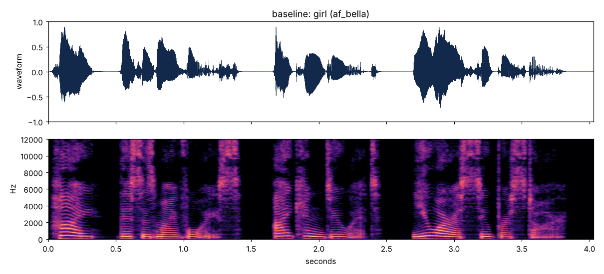
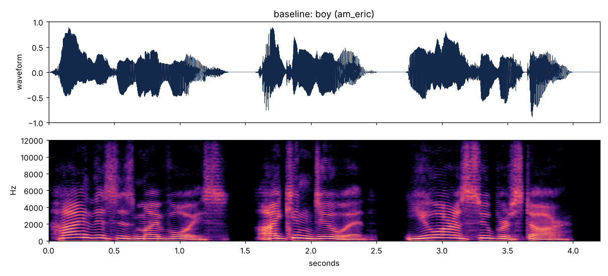

# Audio QA run: baseline

**24 of 45 targets met.**

## Generation (the voice maker's output)

### girl, from af_bella, reshape {'formant': 1.16, 'median': 285, 'range': 1.3, 'duration': 1.06} (6/15 targets met)

| Metric | Target | Value | |
|---|---|---|---|
| dnsmos_ovrl | ≥ 3.25 | 2.9 | ❌ |
| dnsmos_sig | ≥ 3.5 | 3.25 | ❌ |
| dnsmos_bak | ≥ 3.95 | 3.83 | ❌ |
| hnr_db | ≥ 16 | 15 | ❌ |
| jitter_pct | ≤ 1.5 | 1.58 | ❌ |
| shimmer_pct | ≤ 6 | 6.57 | ❌ |
| flutter | ≤ 0.03 | 0.0223 | ✅ |
| clicks | ≤ 0 | 0 | ✅ |
| dropouts | ≤ 0 | 0 | ✅ |
| clipped_samples | ≤ 0 | 0 | ✅ |
| true_peak_dbtp | ≤ -1.0 | -0.778 | ❌ |
| lufs | -17 to -15 | -16.7 | ✅ |
| lufs_spread_lu | ≤ 0.75 | 1.58 | ❌ |
| f0_median_hz | 260 to 300 | 284 | ✅ |
| vocal_tract_scale | 1.18 to 1.3 | 1.15 | ❌ |

### boy, from am_eric, reshape {'formant': 1.25, 'median': 250, 'range': 1.22, 'duration': 1.06} (10/15 targets met)

| Metric | Target | Value | |
|---|---|---|---|
| dnsmos_ovrl | ≥ 3.25 | 3.17 | ❌ |
| dnsmos_sig | ≥ 3.5 | 3.42 | ❌ |
| dnsmos_bak | ≥ 3.95 | 4.04 | ✅ |
| hnr_db | ≥ 16 | 16.5 | ✅ |
| jitter_pct | ≤ 1.5 | 1.47 | ✅ |
| shimmer_pct | ≤ 6 | 5.37 | ✅ |
| flutter | ≤ 0.03 | 0.0204 | ✅ |
| clicks | ≤ 0 | 0 | ✅ |
| dropouts | ≤ 0 | 0 | ✅ |
| clipped_samples | ≤ 0 | 0 | ✅ |
| true_peak_dbtp | ≤ -1.0 | -0.818 | ❌ |
| lufs | -17 to -15 | -15.4 | ✅ |
| lufs_spread_lu | ≤ 0.75 | 1.04 | ❌ |
| f0_median_hz | 230 to 265 | 251 | ✅ |
| vocal_tract_scale | 1.12 to 1.22 | 1.09 | ❌ |

### Girl and boy together (1/3 targets met)

| Metric | Target | Value | |
|---|---|---|---|
| loudness_difference_lu | ≤ 0.5 | 1.27 | ❌ |
| boy_formants_below_girl_pct | 2 to 9 | 5.6 | ✅ |
| quality_difference_ovrl | ≤ 0.15 | 0.263 | ❌ |

## Encoding (MP3 at 48kbps for the built-in packs)

### MP3 encoding (1/2 targets met)

| Metric | Target | Value | |
|---|---|---|---|
| snr_db | ≥ 24 | 21 | ❌ |
| dnsmos_ovrl_loss | ≤ 0.05 | -0.0297 | ✅ |

## Scheduling, buffering and browser playback (captured from the running app)

### Playback path (6/10 targets met)

| Metric | Target | Value | |
|---|---|---|---|
| capture_gaps | ≤ 0 | 0 | ✅ |
| device_voice_used | ≤ 0 | 0 | ✅ |
| clipped_samples | ≤ 0 | 0 | ✅ |
| clicks | ≤ 0 | 1 | ❌ |
| dropouts | ≤ 0 | 0 | ✅ |
| schedule_error_ms_max | ≤ 1 | 0.0227 | ✅ |
| clip_integrity_worst_db | ≤ -25 | -19.5 | ❌ |
| latency_ms_max | ≤ 100 | 87.5 | ✅ |
| clip_lufs_spread_lu | ≤ 1.0 | 1.96 | ❌ |
| girl_boy_lufs_difference | ≤ 0.5 | 2.22 | ❌ |

Joined clips (a message said as several clips): 4 joins, silence between them 53–63 ms.

| Moment | Clips played | Said whole |
|---|---|---|
| Girl: Speak, first time | 3 | no |
| Girl: Speak, again | 1 | yes |
| Girl: typed sentence | 5 | no |
| Boy: Speak, first time | 3 | no |
| Boy: Speak, again | 1 | yes |
| Boy: typed sentence | 4 | no |
