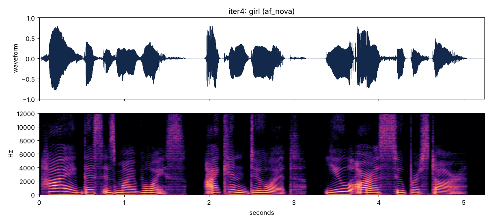
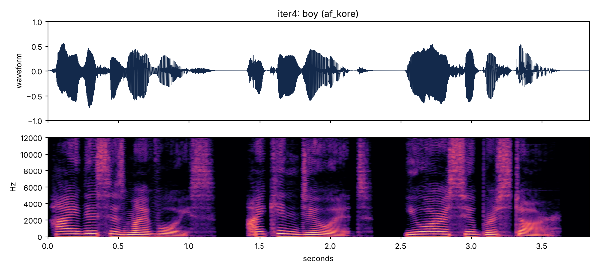

# Audio QA run: iter2

**43 of 45 targets met.**

Before = run **baseline**.

## Generation (the voice maker's output)

### girl, from af_nova, reshape {'formant': 1.26, 'median': 285, 'range': 1.25, 'duration': 1.08} (15/15 targets met)

| Metric | Target | Before | Now | |
|---|---|---|---|---|
| dnsmos_ovrl | ≥ 3.25 | 2.9 | 3.37 | ✅ |
| dnsmos_sig | ≥ 3.5 | 3.25 | 3.65 | ✅ |
| dnsmos_bak | ≥ 3.95 | 3.83 | 4.07 | ✅ |
| hnr_db | ≥ 16 | 15 | 17.4 | ✅ |
| jitter_pct | ≤ 1.5 | 1.58 | 1.24 | ✅ |
| shimmer_pct | ≤ 6 | 6.57 | 4.09 | ✅ |
| flutter | ≤ 0.03 | 0.0223 | 0.0209 | ✅ |
| clicks | ≤ 0 | 0 | 0 | ✅ |
| dropouts | ≤ 0 | 0 | 0 | ✅ |
| clipped_samples | ≤ 0 | 0 | 0 | ✅ |
| true_peak_dbtp | ≤ -1.0 | -0.778 | -1.85 | ✅ |
| lufs | -17 to -15 | -16.7 | -16.2 | ✅ |
| lufs_spread_lu | ≤ 0.75 | 1.58 | 0.217 | ✅ |
| f0_median_hz | 260 to 300 | 284 | 284 | ✅ |
| vocal_tract_scale | 1.18 to 1.3 | 1.15 | 1.26 | ✅ |

### boy, from af_kore, reshape {'formant': 1.16, 'median': 250, 'range': 1.22, 'duration': 1.08} (15/15 targets met)

| Metric | Target | Before | Now | |
|---|---|---|---|---|
| dnsmos_ovrl | ≥ 3.25 | 3.17 | 3.37 | ✅ |
| dnsmos_sig | ≥ 3.5 | 3.42 | 3.63 | ✅ |
| dnsmos_bak | ≥ 3.95 | 4.04 | 4.11 | ✅ |
| hnr_db | ≥ 16 | 16.5 | 17.5 | ✅ |
| jitter_pct | ≤ 1.5 | 1.47 | 1.44 | ✅ |
| shimmer_pct | ≤ 6 | 5.37 | 5.21 | ✅ |
| flutter | ≤ 0.03 | 0.0204 | 0.0153 | ✅ |
| clicks | ≤ 0 | 0 | 0 | ✅ |
| dropouts | ≤ 0 | 0 | 0 | ✅ |
| clipped_samples | ≤ 0 | 0 | 0 | ✅ |
| true_peak_dbtp | ≤ -1.0 | -0.818 | -2.41 | ✅ |
| lufs | -17 to -15 | -15.4 | -16.1 | ✅ |
| lufs_spread_lu | ≤ 0.75 | 1.04 | 0.139 | ✅ |
| f0_median_hz | 230 to 265 | 251 | 251 | ✅ |
| vocal_tract_scale | 1.12 to 1.22 | 1.09 | 1.15 | ✅ |

### Girl and boy together (3/3 targets met)

| Metric | Target | Before | Now | |
|---|---|---|---|---|
| loudness_difference_lu | ≤ 0.5 | 1.27 | 0.184 | ✅ |
| boy_formants_below_girl_pct | 2 to 9 | 5.6 | 8.53 | ✅ |
| quality_difference_ovrl | ≤ 0.15 | 0.263 | 0.00526 | ✅ |

## Encoding (MP3 at 96kbps for the built-in packs)

### MP3 encoding (2/2 targets met)

| Metric | Target | Before | Now | |
|---|---|---|---|---|
| snr_db | ≥ 24 | 21 | 25.8 | ✅ |
| dnsmos_ovrl_loss | ≤ 0.05 | -0.0297 | 0.00891 | ✅ |

## Scheduling, buffering and browser playback (captured from the running app)

### Playback path (8/10 targets met)

| Metric | Target | Before | Now | |
|---|---|---|---|---|
| capture_gaps | ≤ 0 | 0 | 0 | ✅ |
| device_voice_used | ≤ 0 | 0 | 0 | ✅ |
| clipped_samples | ≤ 0 | 0 | 0 | ✅ |
| clicks | ≤ 0 | 1 | 0 | ✅ |
| dropouts | ≤ 0 | 0 | 0 | ✅ |
| schedule_error_ms_max | ≤ 1 | 0.0227 | 0.0227 | ✅ |
| clip_integrity_worst_db | ≤ -25 | -19.5 | -23.6 | ❌ |
| latency_ms_max | ≤ 100 | 87.5 | 1.92e+03 | ❌ |
| clip_lufs_spread_lu | ≤ 1.0 | 1.96 | 0.662 | ✅ |
| girl_boy_lufs_difference | ≤ 0.5 | 2.22 | 0.397 | ✅ |

Joined clips (a message said as several clips): 8 joins, silence between them 56–64 ms.

| Moment | Clips played | Said whole |
|---|---|---|
| Girl: Speak, first time | 3 | no |
| Girl: Speak, again | 3 | no |
| Girl: typed sentence | 5 | no |
| Boy: Speak, first time | 3 | no |
| Boy: Speak, again | 3 | no |
| Boy: typed sentence | 4 | no |
