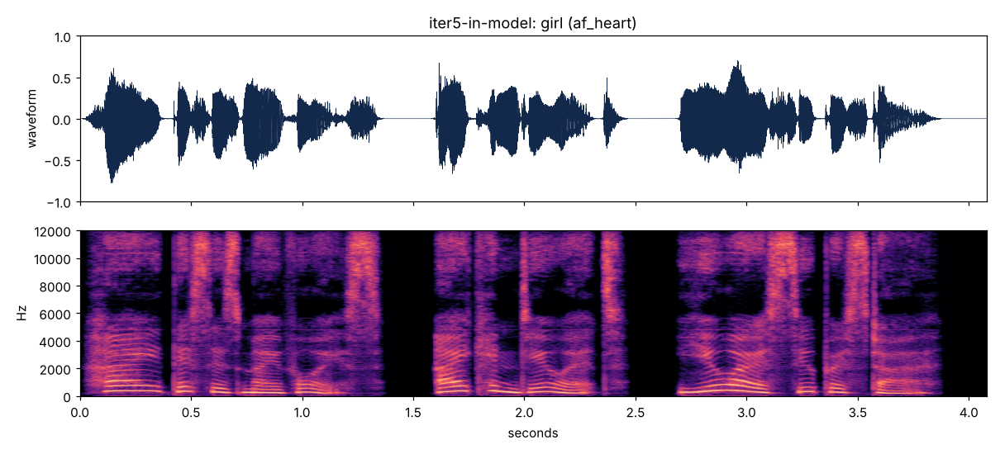
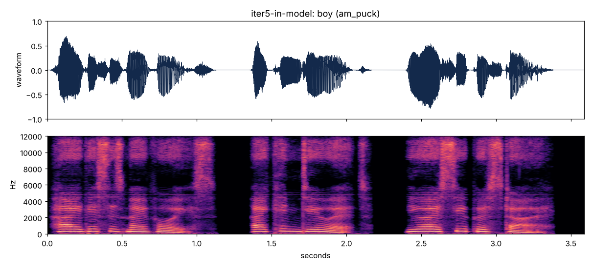

# Audio QA run: iter5-in-model

**42 of 45 targets met.**

Before = run **baseline**.

## Generation (the voice maker's output)

### girl, from af_heart, reshape None (13/15 targets met)

| Metric | Target | Before | Now | |
|---|---|---|---|---|
| dnsmos_ovrl | ≥ 3.25 | 2.9 | 3.29 | ✅ |
| dnsmos_sig | ≥ 3.5 | 3.25 | 3.56 | ✅ |
| dnsmos_bak | ≥ 3.95 | 3.83 | 4.06 | ✅ |
| hnr_db | 10 to 17 | 15 | 12.2 | ✅ |
| jitter_pct | 1.2 to 2.8 | 1.58 | 2.16 | ✅ |
| shimmer_pct | ≤ 6 | 6.57 | 6.51 | ❌ |
| flutter | ≤ 0.03 | 0.0223 | 0.0339 | ❌ |
| clicks | ≤ 0 | 0 | 0 | ✅ |
| dropouts | ≤ 0 | 0 | 0 | ✅ |
| clipped_samples | ≤ 0 | 0 | 0 | ✅ |
| true_peak_dbtp | ≤ -1.0 | -0.778 | -1.98 | ✅ |
| lufs | -17 to -15 | -16.7 | -16.1 | ✅ |
| lufs_spread_lu | ≤ 0.75 | 1.58 | 0.142 | ✅ |
| f0_median_hz | 245 to 285 | 284 | 274 | ✅ |
| vocal_tract_scale | 1.1 to 1.25 | 1.15 | 1.13 | ✅ |

### boy, from am_puck, reshape None (15/15 targets met)

| Metric | Target | Before | Now | |
|---|---|---|---|---|
| dnsmos_ovrl | ≥ 3.25 | 3.17 | 3.31 | ✅ |
| dnsmos_sig | ≥ 3.5 | 3.42 | 3.55 | ✅ |
| dnsmos_bak | ≥ 3.95 | 4.04 | 4.14 | ✅ |
| hnr_db | 10 to 17 | 16.5 | 13.5 | ✅ |
| jitter_pct | 1.2 to 2.8 | 1.47 | 2.26 | ✅ |
| shimmer_pct | ≤ 6 | 5.37 | 5.97 | ✅ |
| flutter | ≤ 0.03 | 0.0204 | 0.0215 | ✅ |
| clicks | ≤ 0 | 0 | 0 | ✅ |
| dropouts | ≤ 0 | 0 | 0 | ✅ |
| clipped_samples | ≤ 0 | 0 | 0 | ✅ |
| true_peak_dbtp | ≤ -1.0 | -0.818 | -1.92 | ✅ |
| lufs | -17 to -15 | -15.4 | -16.1 | ✅ |
| lufs_spread_lu | ≤ 0.75 | 1.04 | 0.0826 | ✅ |
| f0_median_hz | 225 to 260 | 251 | 258 | ✅ |
| vocal_tract_scale | 1.05 to 1.2 | 1.09 | 1.08 | ✅ |

### Girl and boy together (3/3 targets met)

| Metric | Target | Before | Now | |
|---|---|---|---|---|
| loudness_difference_lu | ≤ 0.5 | 1.27 | 0.081 | ✅ |
| boy_formants_below_girl_pct | 2 to 9 | 5.6 | 4.4 | ✅ |
| quality_difference_ovrl | ≤ 0.15 | 0.263 | 0.0139 | ✅ |

## Encoding (MP3 at 96kbps for the built-in packs)

### MP3 encoding (1/2 targets met)

| Metric | Target | Before | Now | |
|---|---|---|---|---|
| snr_db | ≥ 24 | 21 | 21.6 | ❌ |
| dnsmos_ovrl_loss | ≤ 0.05 | -0.0297 | 0.00832 | ✅ |

## Scheduling, buffering and browser playback (captured from the running app)

### Playback path (10/10 targets met)

| Metric | Target | Before | Now | |
|---|---|---|---|---|
| capture_gaps | ≤ 0 | 0 | 0 | ✅ |
| device_voice_used | ≤ 0 | 0 | 0 | ✅ |
| clipped_samples | ≤ 0 | 0 | 0 | ✅ |
| clicks | ≤ 0 | 1 | 0 | ✅ |
| dropouts | ≤ 0 | 0 | 0 | ✅ |
| schedule_error_ms_max | ≤ 1 | 0.0227 | 0 | ✅ |
| clip_integrity_worst_db | ≤ -25 | -19.5 | -223 | ✅ |
| latency_ms_max | ≤ 100 | 87.5 | 36.7 | ✅ |
| clip_lufs_spread_lu | ≤ 1.0 | 1.96 | 0.874 | ✅ |
| girl_boy_lufs_difference | ≤ 0.5 | 2.22 | 0.32 | ✅ |

Joined clips (a message said as several clips): 4 joins, silence between them 47–59 ms.

| Moment | Clips played | Said whole |
|---|---|---|
| Girl: Speak, first time | 3 | no |
| Girl: Speak, again | 1 | yes |
| Girl: typed sentence | 5 | no |
| Boy: Speak, first time | 3 | no |
| Boy: Speak, again | 1 | yes |
| Boy: typed sentence | 4 | no |
