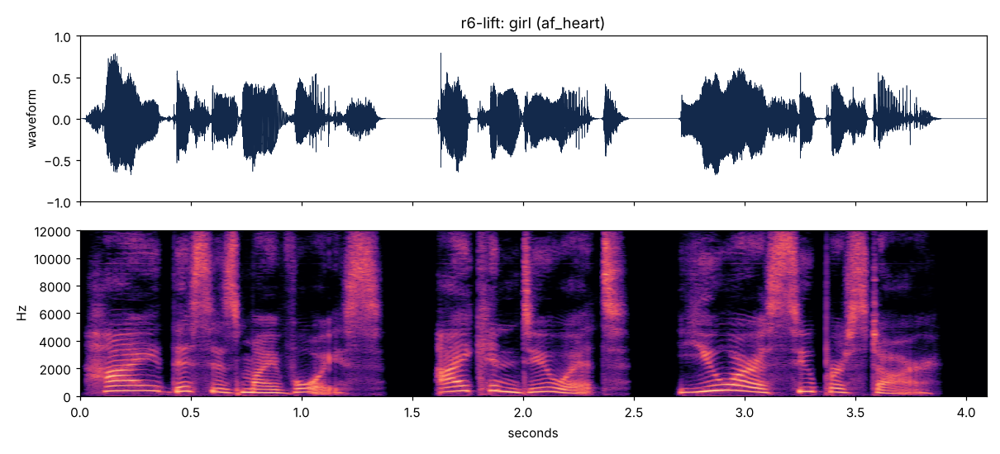
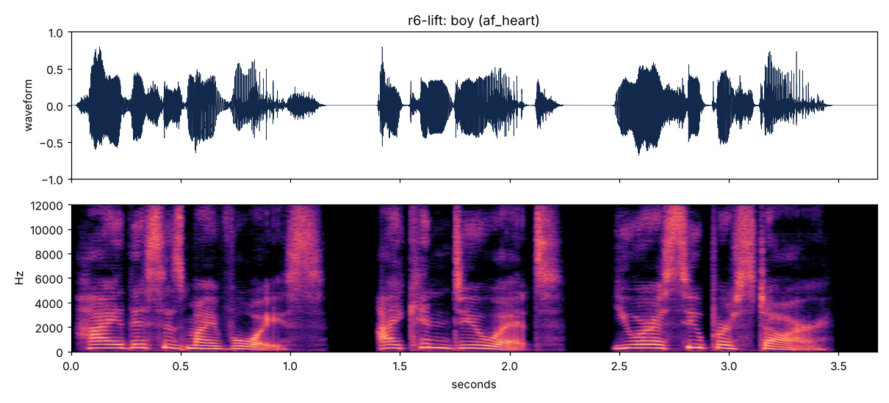

# Audio QA run: r6-lift

**39 of 39 targets met.**

## Generation (the voice maker's output)

### girl, from af_heart, reshape None (18/18 targets met)

| Metric            | Target       | Value  |     |
| ----------------- | ------------ | ------ | --- |
| dnsmos_ovrl       | ≥ 2.9        | 2.96   | ✅  |
| dnsmos_sig        | ≥ 3.35       | 3.41   | ✅  |
| dnsmos_bak        | ≥ 3.6        | 3.68   | ✅  |
| hnr_db            | 8 to 17      | 9.39   | ✅  |
| jitter_pct        | 1.2 to 2.8   | 2.37   | ✅  |
| shimmer_pct       | ≤ 9          | 8.22   | ✅  |
| flutter           | ≤ 0.1        | 0.0766 | ✅  |
| clicks            | ≤ 0          | 0      | ✅  |
| dropouts          | ≤ 0          | 0      | ✅  |
| clipped_samples   | ≤ 0          | 0      | ✅  |
| true_peak_dbtp    | ≤ -1.0       | -1.7   | ✅  |
| lufs              | -17 to -15   | -16.3  | ✅  |
| lufs_spread_lu    | ≤ 0.75       | 0.203  | ✅  |
| r_dip             | ≤ 0.82       | 0.762  | ✅  |
| word_accuracy_pct | ≥ 50         | 58.2   | ✅  |
| sentence_wer_pct  | ≤ 40         | 29.3   | ✅  |
| f0_median_hz      | 245 to 290   | 281    | ✅  |
| vocal_tract_scale | 1.04 to 1.12 | 1.07   | ✅  |

### boy, from af_heart, reshape None (18/18 targets met)

| Metric            | Target      | Value  |     |
| ----------------- | ----------- | ------ | --- |
| dnsmos_ovrl       | ≥ 3.25      | 3.45   | ✅  |
| dnsmos_sig        | ≥ 3.5       | 3.66   | ✅  |
| dnsmos_bak        | ≥ 3.95      | 4.17   | ✅  |
| hnr_db            | 8 to 17     | 9.62   | ✅  |
| jitter_pct        | 1.2 to 2.8  | 2.07   | ✅  |
| shimmer_pct       | ≤ 9         | 7.85   | ✅  |
| flutter           | ≤ 0.1       | 0.0564 | ✅  |
| clicks            | ≤ 0         | 0      | ✅  |
| dropouts          | ≤ 0         | 0      | ✅  |
| clipped_samples   | ≤ 0         | 0      | ✅  |
| true_peak_dbtp    | ≤ -1.0      | -1.9   | ✅  |
| lufs              | -17 to -15  | -16.2  | ✅  |
| lufs_spread_lu    | ≤ 0.75      | 0.209  | ✅  |
| r_dip             | ≤ 0.82      | 0.754  | ✅  |
| word_accuracy_pct | ≥ 50        | 72.7   | ✅  |
| sentence_wer_pct  | ≤ 40        | 31.9   | ✅  |
| f0_median_hz      | 235 to 270  | 262    | ✅  |
| vocal_tract_scale | 1.0 to 1.08 | 1.04   | ✅  |

### Girl and boy together (3/3 targets met)

| Metric                      | Target | Value  |     |
| --------------------------- | ------ | ------ | --- |
| loudness_difference_lu      | ≤ 0.5  | 0.0208 | ✅  |
| boy_formants_below_girl_pct | 1 to 9 | 2.31   | ✅  |
| quality_difference_ovrl     | ≤ 0.55 | 0.492  | ✅  |
